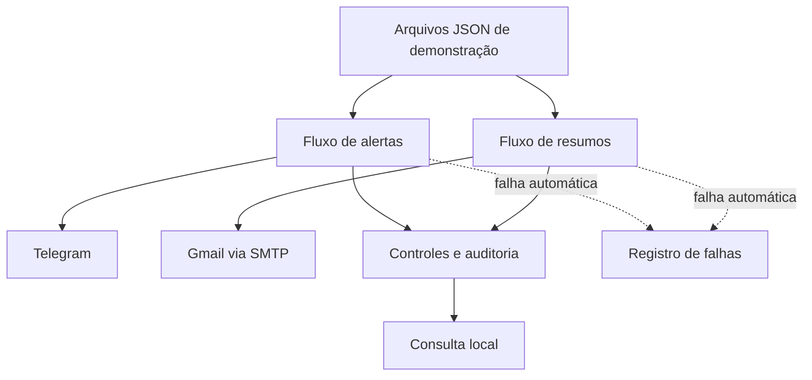

# Energia que dá Lucro — automações com n8n

Projeto acadêmico de RPA para demonstrar como pequenas lojas podem receber alertas de desperdício de energia e resumos periódicos. A solução usa **dados fictícios em arquivos JSON**, envia alertas pelo Telegram e resumos por Gmail, e oferece uma página local para consultar os registros. Não há sensores reais integrados neste protótipo.

**Global Solution — FIAP | Engenharia de Software**

- João Pedro Marques Rodrigues — RM 98307
- Gustavo H. S. Bonfim — RM 98864
- Kayky P. Ribeiro — RM 99929
- Lucas Y. F. Umada — RM 99757
- Natan E. dos Santos — RM 98720

## O que o projeto faz

1. Lê ocorrências simuladas de equipamentos e dados das lojas.
2. Analisa os eventos e envia pelo Telegram alertas elegíveis de porta aberta.
3. Lê resumos e recomendações já preparados e envia relatórios semanais e mensais por e-mail.
4. Registra as decisões e os envios em arquivos de controle, para evitar repetições e permitir auditoria.
5. Disponibiliza uma página local que apresenta os arquivos de controle selecionados pelo usuário.
6. Possui um terceiro fluxo para registrar falhas de execução dos outros fluxos, quando configurado como fluxo de erro no n8n.

O objetivo é demonstrar o processo de automação, não medir uma economia real. Os valores, eventos, lojas e recomendações são exemplos; os dados de entrada não são coletados automaticamente de equipamentos. As recomendações também são fictícias: não há integração com IA nem referência técnica validada no projeto.

## Organização dos arquivos

| Caminho | Conteúdo |
|---|---|
| `workflows/01_alertas.json` | Fluxo de alertas para importação no n8n. |
| `workflows/02_resumos_gmail.json` | Fluxo de resumos para importação. |
| `workflows/03_registro_de_falhas.json` | Fluxo auxiliar para registrar falhas. |
| `dados/exemplos/` | Arquivos de entrada fictícios e controles vazios para uma demonstração nova. |
| `evidencias/registros/` | Cópias dos controles após os testes realizados; não use como controles iniciais se desejar reproduzir os envios. |
| `evidencias/prints/` | Imagens das execuções, mensagens e auditoria. |
| `consulta/consulta.html` | Página de consulta local dos controles. |
| `documentacao/` | Diagramas BPMN dos dois fluxos principais, em PDF e formato editável. |
| `tests/PLANO_DE_TESTES.md` | Resultados observados, imagens e limites da validação. |

Os arquivos de evidência preservam os registros de teste e são separados dos exemplos iniciais. Destinatários e credenciais foram removidos das cópias do pacote: cada pessoa que executar deve configurar os próprios dados. Não publique tokens, senhas ou destinatários reais no repositório.

## Visão geral da solução



O fluxo de falhas depende de configuração e de execução automática dos fluxos vinculados. A página local lê os controles selecionados; ela não acessa o n8n automaticamente. Os BPMNs representam os processos em nível conceitual; os JSONs são a referência para os detalhes de implementação.

## Fluxo 1 — alertas no Telegram

**Arquivo:** `workflows/01_alertas.json`.

O fluxo começa manualmente ou pelo agendamento, lê `/files/eventos.json` e `/files/lojas.json`, e percorre os eventos. Para cada um, lê `controle_alertas.json` e verifica dados como identificador, loja, equipamento, tipo, duração e início. Entre as regras implementadas:

- O evento precisa ser válido, corresponder a uma loja e equipamento cadastrados e ter data e duração válidas.
- A regra de alerta se aplica a `porta_aberta` com duração **superior a 60 segundos**; eventos fora da regra são registrados como ignorados.
- O início do evento deve estar no horário de funcionamento da loja, interpretado em seu fuso horário.
- Se já houver registro para aquele evento, a decisão indica duplicidade.
- Para um evento elegível, o fluxo registra uma reserva antes do envio; depois registra o resultado como `enviado` ou `incerto`, conforme a resposta disponível.

A mensagem identifica loja, equipamento e duração. No teste apresentado, foram recebidos dois alertas: expositor da padaria por 95 segundos e freezer do mercado por 120 segundos. O controle tem quatro envios registrados no total, pois também inclui a execução anterior.

**Agendamento:** existe um nó chamado `A cada 5 minutos`. No JSON exportado, o intervalo numérico não está explícito; confira no editor do n8n se está configurado para 5 minutos antes de publicar. Uma execução manual bem-sucedida não comprova que o agendamento foi validado.

## Fluxo 2 — resumos pelo Gmail

**Arquivo:** `workflows/02_resumos_gmail.json`.

Há três entradas: demonstração manual; segunda-feira às 08h, para o período semanal anterior; e dia 1 às 08h, para o mês anterior. O fluxo lê as lojas, os resumos e as recomendações, monta combinações de loja e período, verifica o arquivo `controle_resumos.json` e reserva os envios elegíveis. O e-mail informa o período, o desperdício estimado, o custo, os equipamentos e uma recomendação encontrada para a loja e mês.

A chave de controle combina loja, periodicidade e período. Se ela já existir, o item é tratado como duplicado. Com dados válidos e destinatário configurado, o Gmail recebe o envio via SMTP; depois o fluxo registra o resultado. `enviado` indica que o servidor SMTP aceitou a mensagem; a confirmação de recebimento no teste vem também da caixa de entrada fotografada.

A demonstração manual usa períodos fixos: **02/11/2026 a 08/11/2026** e **outubro de 2026**. Para as execuções agendadas de outras datas, é necessário fornecer resumos e recomendações correspondentes: os arquivos de exemplo não são atualizados automaticamente. Configure e confira o fuso horário do workflow e da instância do n8n para que as 08h sejam interpretadas como esperado.

## Fluxo 3 — registro de falhas

**Arquivo:** `workflows/03_registro_de_falhas.json`.

O fluxo começa com um gatilho de erro do n8n. Ele prepara um registro com data, identificadores disponíveis, nó e categoria resumida, e o acrescenta em `/files/falhas_execucao.jsonl`. O objetivo é reduzir a exposição de detalhes sensíveis; a investigação completa deve ser feita em **Executions** no n8n.

Após importar os três fluxos, publique o fluxo de falhas e selecione-o como **Error Workflow** nas configurações dos dois fluxos principais. As referências originais foram removidas dos arquivos do pacote, pois os identificadores mudam entre instalações.

**Limite da evidência:** foi fotografada uma falha em execução manual no nó `Interpretar eventos`. Essa imagem demonstra o erro no editor; ela não comprova o acionamento automático do fluxo de falhas. O registro automático ainda precisa de validação específica.

## Arquivos de dados

Os nós usam o diretório `/files` dentro do ambiente em que o n8n executa. Ao usar Docker, essa pasta deve estar mapeada para uma pasta do computador.

| Arquivo | Papel |
|---|---|
| `lojas.json` | Lista de lojas, horários, equipamentos e destinatários. Preencha `destinatarios.email` e `destinatarios.telegram_chat_id` para seu ambiente. |
| `eventos.json` | Lista de eventos com ID, loja, equipamento, tipo, início e duração. Contém casos elegíveis e casos de decisão para demonstração. |
| `resumos.json` | Indicadores já calculados por loja, período e equipamento. |
| `recomendacoes.json` | Recomendações ilustrativas por loja e mês. |
| `controle_alertas.json` | Reservas, resultados e logs dos alertas. |
| `controle_resumos.json` | Reservas, resultados e logs dos resumos. |
| `falhas_execucao.jsonl` | Registro de falhas, uma linha JSON por registro; o exemplo começa com um marcador inicial. |

Os números de desperdício e custo são dados do arquivo de resumo, não resultados de cálculo ou medição realizados pelo fluxo. Os horários dos eventos de exemplo estão no passado; são dados de demonstração.

## Preparação e execução

### 1. Preparar o n8n e a pasta de arquivos

É necessário ter uma instância n8n com acesso à leitura e escrita em `/files` e acesso à internet para Telegram e Gmail. Na instalação usada no projeto, o n8n roda em Docker e a pasta `GS2026-dados` do Windows está vinculada a `/files` no contêiner.

1. Copie os sete arquivos de `dados/exemplos/` para a pasta mapeada a `/files`.
2. Em `lojas.json`, preencha o e-mail de destino e o ID do chat do Telegram de cada loja. Inicie o bot na conversa escolhida antes de enviar alertas.
3. Preserve uma cópia dos arquivos de controle existentes antes de substituí-los: os controles vazios permitem uma nova demonstração e a substituição apaga o histórico local utilizado pelo fluxo.
4. Confira se o contêiner realmente vê esses arquivos em `/files` e tem permissão para modificá-los. Uma pasta no Windows por si só não cria esse mapeamento.

Caso ainda não tenha o volume configurado, um exemplo para **PowerShell no Windows**, em uma instalação nova, é mostrado abaixo. O caminho da pasta deve existir. Não execute uma segunda instância simultânea sobre os mesmos arquivos: o controle baseado em arquivos não garante exclusão mútua. A porta 5678 precisa estar livre.

```powershell
New-Item -ItemType Directory -Force "$env:USERPROFILE\GS2026-dados"
docker volume create gs2026_n8n_data
docker run -d --name gs2026-n8n -p 5678:5678 `
  -e GENERIC_TIMEZONE=America/Sao_Paulo -e TZ=America/Sao_Paulo `
  -e N8N_RESTRICT_FILE_ACCESS_TO=/files `
  -v gs2026_n8n_data:/home/node/.n8n `
  --mount "type=bind,source=$env:USERPROFILE\GS2026-dados,target=/files" `
  n8nio/n8n
```

Depois, acesse `http://localhost:5678`. A configuração e a versão do n8n podem variar; se já existir uma instância funcionando, aproveite sua configuração e confira o volume, em vez de criar outra. Mantenha o Docker e o n8n ligados para execuções agendadas.

### 2. Importar e configurar

1. No n8n, importe os três arquivos de `workflows/`, um por vez. Eles são cópias dos fluxos atualizados, sem credenciais e sem vínculo de fluxo de erro da instalação original.
2. No nó `Enviar Telegram`, crie ou selecione uma credencial de bot própria. O chat de destino vem de `lojas.json`.
3. No nó `Enviar pelo Gmail`, crie ou selecione uma credencial SMTP do Gmail: servidor `smtp.gmail.com`, porta `465`, SSL/TLS ativado, usuário com o endereço Gmail e senha de app criada na conta Google. Configure também o remetente no nó; o endereço de exemplo precisa ser substituído.
4. Publique o fluxo de falhas e vincule-o aos dois principais nas configurações de cada workflow. Confira também o caminho de cada arquivo e o agendamento.
5. Salve as alterações. Para agendamentos, publique os fluxos principais após verificar destinos e horários. Faça uma execução por vez.

As credenciais são configuradas no n8n e não devem ser copiadas para o JSON, o README ou o Git. Os e-mails e IDs de chat locais também devem ser tratados com cuidado.

### 3. Executar a demonstração

- Em **Alertas**, inicie por `Iniciar manualmente` e execute o fluxo. Para eventos elegíveis ainda não registrados, verifique o recebimento no Telegram e abra o controle atualizado.
- Em **Resumos Gmail**, use `Executar demonstração`. Com os controles de exemplo vazios, resumos correspondentes e destinos configurados, as duas lojas e os dois períodos fornecem quatro combinações. Confira no Gmail e no controle.
- Repita a demonstração dos resumos com os mesmos controles para verificar a decisão de duplicidade. Não apague reservas nem registros para forçar reenvio sem antes verificar o que ocorreu.

A demonstração envia mensagens reais aos destinatários configurados. Se um envio ficar `reservado` ou `incerto`, confira o destino e a execução antes de qualquer intervenção: uma reserva pode permanecer após interrupção. A proteção por arquivos reduz duplicações, mas não garante entrega exatamente uma vez nem protege contra execuções simultâneas.

### 4. Consultar resultados

Abra `consulta/consulta.html` no navegador. Selecione o `controle_alertas.json` produzido pelo fluxo no primeiro campo e o `controle_resumos.json` no segundo. Após nova execução, selecione novamente os arquivos para atualizar a página. Ela mostra contagens, listas e auditoria dos controles carregados; não confirma, por si só, a entrega ao destinatário.

Para ver os resultados já registrados sem executar de novo, selecione as cópias em `evidencias/registros/`. Para ver a execução atual, selecione os arquivos da pasta mapeada a `/files`.

## Evidências e resultados observados

| Cenário | Resultado observado | Evidência |
|---|---|---|
| Alertas | Execução concluída e duas mensagens recebidas no Telegram. | `01_alertas_fluxo.png`, `02_telegram_recebimento.png` |
| Regras dos alertas | Painel mostra quatro alertas acumulados e auditoria inclui envio, duplicidade, dado inválido e eventos ignorados. | `03_consulta_alertas.png`, `04_auditoria_alertas.png` |
| Resumos | Quatro combinações processadas e quatro e-mails exibidos na caixa de entrada. | `05_resumos_fluxo.png`, `06_resumos_caixa_entrada.png` |
| Controle de resumos | Quatro resumos registrados como enviados e auditoria das reservas e dos envios. | `07_consulta_resumos.png`, `08_auditoria_resumos.png` |
| Duplicidade de resumos | Nova execução concluiu sem novo e-mail; auditoria mostra quatro decisões `duplicado`. | `10_duplicidade_fluxo.png`, `11_duplicidade_auditoria.png` |
| Falha manual | Erro em `Interpretar eventos` exibido no editor. | `09_falha_manual.png` |

Imagens estão em `evidencias/prints/`; registros de teste estão em `evidencias/registros/`. O roteiro e os limites estão em `tests/PLANO_DE_TESTES.md`. As capturas representam uma execução específica e os dados de teste permanecem fictícios. Os testes demonstram os caminhos registrados, não todos os cenários possíveis.

## Limitações e evolução

- Não há integração com sensores, cálculo automático do consumo ou atualização automática dos arquivos de origem.
- Os dados de demonstração e as recomendações são ilustrativos; não representam economia comprovada nem orientação técnica validada.
- O armazenamento em arquivos exige cópias de segurança e não foi projetado para várias execuções simultâneas.
- Falhas automáticas, agendamentos em produção e testes exaustivos permanecem a validar.
- Recomenda-se, em uma evolução, substituir arquivos compartilhados por armazenamento transacional, integrar fonte real de dados, adicionar monitoramento e controlar acesso aos dados.

## Entrega acadêmica

O repositório reúne fluxos, dados demonstrativos, BPMNs, página de consulta e evidências. O relatório completo deve ser desenvolvido separadamente com as capturas, interpretação dos testes e os requisitos específicos informados pelo professor. O vídeo de apresentação também deve ser preparado e seu link acrescentado quando estiver disponível.
